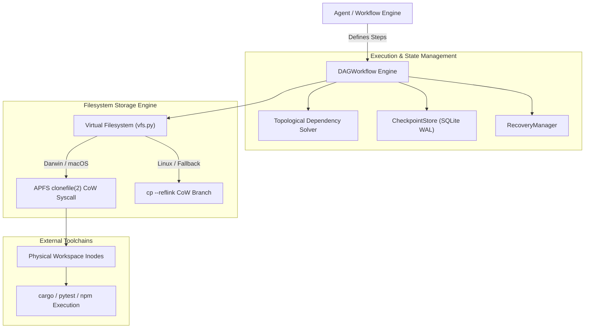

# Architecture Specification: chronos-orchestrator

## 1. System Architecture Diagram

---

## 2. Component Blueprint
- **`chronos/dag.py`**: Multi-step graph scheduler with concurrency backpressure, automated rollbacks, and Mermaid export.
- **`chronos/vfs.py`**: Copy-on-Write branch manager leveraging `libc.clonefile` for sub-millisecond physical clones.
- **`chronos/recovery.py`**: State restoration coordinator applying snapshot trees back to disk.
- **`chronos/checkpoint.py`**: Persistent snapshot ledger tracking file manifests and SHA hashes.
